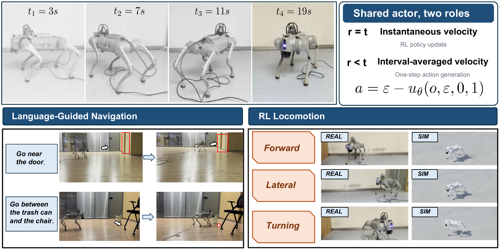
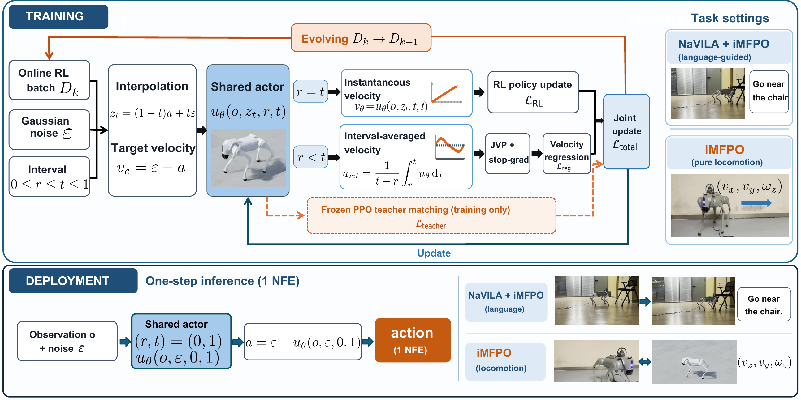
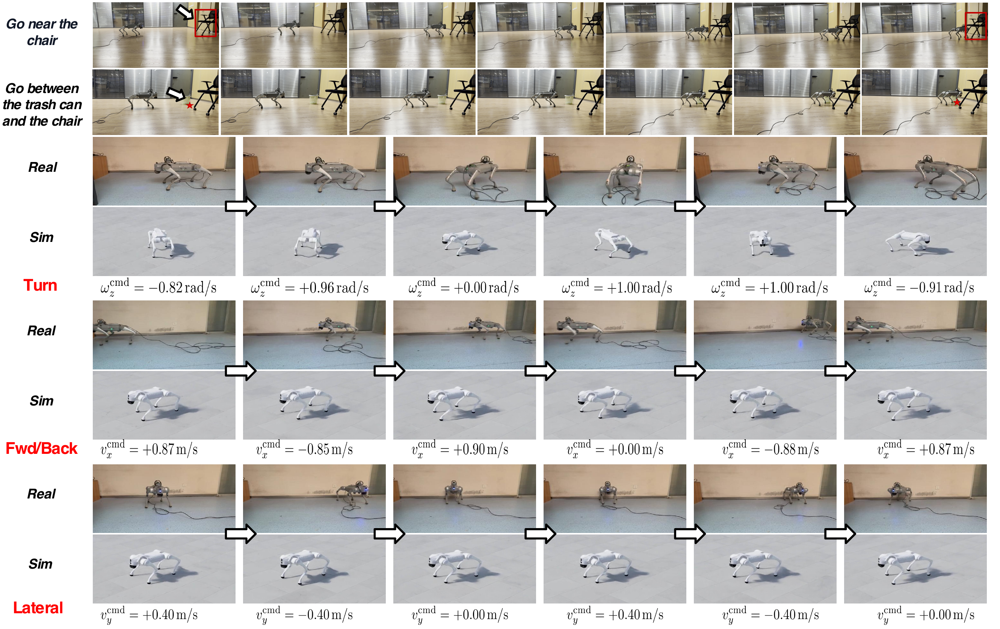

# iMFPO: Improving Mean Flow Policy Optimization with Drift-Aware Velocity Alignment for Embodied Control

This is the official repository for the paper:
> iMFPO: Improving Mean Flow Policy Optimization with Drift-Aware Velocity Alignment for Embodied Control
>
> Lisiyu Pan\*, [Ting Huang](https://believeht029.github.io/)\*, [Zeyu Zhang](https://steve-zeyu-zhang.github.io/)<sup>†</sup>, and [Hao Tang](https://ha0tang.github.io/)<sup>‡</sup>
>
> School of Computer Science, Peking University
>
> <sup>*</sup>Equal contribution. <sup>†</sup>Project lead. <sup>‡</sup>Corresponding author.
>
> ### [Paper](https://arxiv.org/abs/xxxx) | [Website](https://aigeeksgroup.github.io/iMFPO/) | [Model](https://huggingface.co/AIGeeksGroup/iMFPO)

---

## 🥳Introduction

iMFPO is a one-step generative policy optimization framework for embodied control. A shared interval-conditioned actor learns instantaneous velocity for reward-driven policy optimization and interval-averaged velocity for direct action generation. Drift-aware velocity alignment combines JVP-corrected velocity regression with the policy objective, while a frozen PPO teacher provides action-level guidance during training. At deployment, the actor generates an action in one network function evaluation (1 NFE), without iterative flow integration or teacher inference.

The paper evaluates velocity-tracking locomotion on Go2, G1, H1, and Spot, together with qualitative Go2 real-robot locomotion and language-guided navigation demonstrations.



## 📦Code and resources

| Resource | Location | Use |
| --- | --- | --- |
| iMFPO actor, objective, and runner | `source/isaaclab_fpo/` | Training and one-step inference |
| Robot task definitions | `source/unitree_rl_lab/` | Go2, G1-29DoF, H1, and Spot in Isaac Lab |
| PPO teacher scripts | `scripts/rsl_rl/`, `scripts/run_ppo_teacher.sh` | Training-time teacher |
| iMFPO scripts | `scripts/fpo/`, `scripts/run_imfpo.sh` | Training, evaluation, playback, and ONNX export |
| Paper figures | `assets/` | Teaser, framework, and real/simulation keyframes |

Isaac Lab / Isaac Sim, robot assets, trained checkpoints, and the physical-robot deployment stack are not bundled with this repository.

## 🧩Method



The same actor handles two interval settings. A zero-length interval supplies instantaneous-velocity supervision for policy learning; a full interval predicts the average velocity used to generate an action directly. Training combines reward-driven updates, JVP-corrected velocity regression, and guidance from a frozen PPO teacher. The teacher is not part of the deployed policy.

## ⚙️Environment setup

Use a Linux environment with an NVIDIA GPU and an existing Isaac Lab / Isaac Sim installation. Set the paths to your Isaac Lab environment and robot assets before installing the local packages:

```bash
git clone https://github.com/AIGeeksGroup/iMFPO.git
cd iMFPO

source /path/to/isaaclab_experiments/source_env.sh
export ISAAC_ROOT=/path/to/isaaclab_experiments
export PYTHONPATH="$PWD/source/isaaclab_fpo:$PWD/source/unitree_rl_lab:${PYTHONPATH:-}"
export UNITREE_MODEL_DIR=/path/to/unitree_model  # required for G1 / H1 USD assets

python -m pip install -e source/isaaclab_fpo
python -m pip install -e source/unitree_rl_lab
```

Use the Isaac Lab environment's Python interpreter for the commands below.

## 🔥Training

Train a PPO teacher, then train iMFPO using its checkpoint for training-time action guidance:

```bash
GPU=0 TASK=Unitree-Go2-Velocity MAX_ITERS=3000 \
  bash scripts/run_ppo_teacher.sh

GPU=0 TASK=Unitree-Go2-Velocity \
TEACHER_CHECKPOINT=/path/to/ppo_teacher.pt \
  bash scripts/run_imfpo.sh
```

For another embodiment, change `TASK` and supply its matching teacher checkpoint. For example:

```bash
GPU=0 TASK=Unitree-G1-29dof-Velocity \
TEACHER_CHECKPOINT=/path/to/g1_ppo_teacher.pt \
  bash scripts/run_imfpo.sh
```

The scripts also accept `NUM_ENVS`, `MAX_ITERS`, `SEED`, `RUN_NAME`, `WORKDIR`, `RESUME=1`, and `CHECKPOINT=/path/to/model.pt` as environment overrides.

## 📊Evaluation

The paper reports mean episode return under zero-latent evaluation (higher is better):

| Method | NFE | Go2 | G1 | H1 | Spot |
| --- | ---: | ---: | ---: | ---: | ---: |
| RFPO | 64 | 35.58 | 32.55 | 416.06 | 28.19 |
| RFPO | 1 | 35.16 | 33.59 | 412.40 | 27.89 |
| **iMFPO** | **1** | **35.69** | **34.44** | **416.23** | **29.86** |

Return scales differ by robot task. On Go2, batch-size-one actor latency (p50) is 0.41 ms for 1-NFE iMFPO and 15.57 ms for 64-NFE RFPO, approximately a 38× reduction at comparable return. The paper averages 256 episodes per result unless otherwise specified; real-robot demonstrations are qualitative.

Evaluate a trained checkpoint or inspect a rollout with the supplied scripts:

```bash
python scripts/fpo/eval_imfpo.py --help
python scripts/fpo/eval_rsl_ppo.py --model_checkpoint /path/to/ppo_teacher.pt
python scripts/fpo/play.py --help
```

## 🤖Visualization and real-robot demonstrations

The paper includes matched real-robot and simulation keyframes for forward/backward, lateral, and turning commands, plus language-guided Go2 navigation sequences:



Use `python scripts/fpo/play.py --help` for playback options. The `--viser` option provides an interactive scene with robot meshes and a ground grid.

## 🚀Export for deployment

Export a trained iMFPO checkpoint to ONNX:

```bash
python scripts/fpo/export_onnx.py \
  --checkpoint /path/to/imfpo/model_2499.pt \
  --sampling-steps 1 \
  --out-dir /path/to/exported
```

For Go2, the deployment interface is a 45-D observation, a 12-D joint-position action, one network evaluation, and 50 Hz control. Use the matching joint order, default pose, action scale, observation normalization, and PD configuration when connecting the exported policy to the robot.

## 🧪Verification

CPU regression and smoke checks are available:

```bash
python tests/test_meanflow.py
python tests/smoke_runner_mock_env.py
```

Before hardware deployment, validate the exported ONNX in closed-loop simulation and verify the robot-specific joint mapping and control configuration.

## 🫶Acknowledgements

This project builds on Isaac Lab, Isaac Sim, RSL-RL, and the Unitree locomotion environments. We thank their authors and maintainers for the open-source infrastructure. See [LICENCE](LICENCE) for repository licensing.
